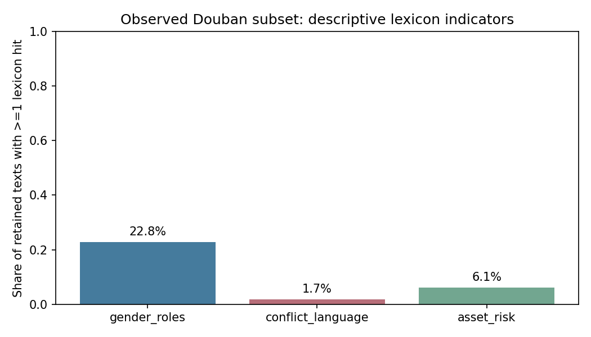

# Caili Discourse Analysis

**Dingyu Zhang · Waseda University, School of International Liberal Studies**

An offline Chinese text-analysis portfolio project exploring marriage, bride price
(彩礼), gender roles and household asset risk. It combines text cleaning, jieba
segmentation, TF-IDF, NMF topic exploration and transparent lexicon indicators.

**Start with [the executed demonstration notebook](caili_analysis.ipynb).** Public
examples are entirely synthetic. The real social-media corpus is not redistributed.



This figure summarizes the supplied observed subset using **new illustrative
lexicons**; it is not a cross-platform result or a replication of the report.

## Scope and evidence

The original course report described a Tieba–Douban comparison of 2,366 items and
reported platform-classification accuracy of 87.3%. Those are historical report
claims, not reproduced results of this repository. The files available for this
revision contain **363 records from one Douban group across 142 topics**; they do
not include Tieba data or the complete analysis code used for the report. The source
CSV timestamps span January 4–24, 2026; this describes the supplied file, not an
independently verified collection period.

This revision therefore demonstrates a **single-platform exploratory workflow**.
It also implements optional thread-disjoint platform classification for a future
authorized two-platform input. Classification is skipped for the supplied data.
There is no new platform accuracy claim and no inference about users' gender.

## What the code does

1. Validate the corpus schema and retain source thread grouping.
2. Normalize Unicode and whitespace, remove URLs, mentions, HTML tags and timestamps.
3. Remove very short texts and exact duplicates after normalization.
4. Segment Chinese with jieba; learn TF-IDF and exploratory NMF components.
5. Normalize each document's NMF weights before computing descriptive means.
6. Calculate three explicit lexicon indicators: gender roles, conflict language
   and asset risk. Export activation rate, zero rate and hits per 100 Chinese characters.
7. For exactly two platforms, fit a fixed TF-IDF/logistic regression pipeline on
   training data only and evaluate on different threads, with a majority baseline.

The lexicons in `analysis.py` are **new illustrative operational definitions**,
not a reconstruction of the original report's unavailable lexicons. Substring
counts can overlap and do not resolve negation, sarcasm or context. Activation
rate is the fraction of texts with a hit; zero rate is its complement. Topic
components and keyword counts are descriptive, not significance tests or causal evidence.

## Reproduce the public demo

Validated with Python 3.12. Create and activate a virtual environment, then run from
the repository root:

```bash
python -m pip install -r requirements.txt
python analysis.py --input data/synthetic_demo.csv --output results/demo --demo
python -m unittest discover -s tests -v
```

The fixture contains 60 original fabricated texts in 30 synthetic topics. It is
designed to illustrate code behavior, not to approximate a representative sample.
All figures and topic-word outputs under `results/demo/` are synthetic results.

To explore interactively:

```bash
python -m notebook
```

Open `caili_analysis.ipynb` and run all cells from the repository root. Notebook
outputs were captured by sequential execution in a shared Python namespace; the
build environment could not use Jupyter kernel transport. Interactive kernel
execution was not verified there.

## Run on your private corpus

Place authorized data in `private/corpus.csv`, with `text` and `topic_id` or
`thread_id`. Add `platform` when using multiple platforms; absent labels default
to `douban`. Then run:

```bash
python analysis.py --input private/corpus.csv --output private/results
```

This accepts the supplied CSV schema without the Colab `common` module. Real-data
results must stay inside `private/`, which is gitignored. Topic terms can still be
sensitive; do not copy private outputs into a public repository without review.
Text cleaning is **not** a guarantee of anonymization.

For optional cross-platform classification, merge authorized inputs into one CSV,
retain actual platform labels and original topic IDs across every comment/page.
The grouping key combines platform and topic ID. Exact normalized text duplicates
are removed before splitting. A fixed seeded group split ensures both platforms
appear on each side; split attempts inspect labels only, not performance. The
model uses no test-set vocabulary fitting or hyperparameter search. One split
still cannot establish stable cross-platform generalization.

## Collection-code revision

The supplied crawler embedded login credentials, depended on an unavailable
`common` module, contained an isolated invalid syntax line and called an undefined
cookie-test function. Its output schema also differed from the supplied CSV.
Copying it into a public notebook would not create a reproducible collection pipeline.

[parse_saved_html.py](parse_saved_html.py) provides an offline extraction component
for locally saved HTML. It makes no network requests, accepts no login cookies,
and selects content containers instead of entire reply rows. Each file must
represent one complete topic. Example:

```bash
python parse_saved_html.py --html-dir private/html --output private/parsed.csv
```

The parser is checked against a fabricated HTML fixture. It has not been validated
against saved pages from this collection; actual DOM variants require inspection.
It does not claim to reproduce the supplied CSV or bypass access restrictions.

## Files

| File | Purpose |
| --- | --- |
| `caili_analysis.ipynb` | Executed synthetic demonstration |
| `analysis.py` | Offline NLP workflow and optional grouped platform classifier |
| `parse_saved_html.py` | Local HTML extraction, no credentials or network |
| `data/synthetic_demo.csv` | Entirely fabricated public examples |
| `results/demo/` | Reproducible synthetic outputs |
| `observed_data_audit.json` | Counts from the supplied file; no posts or topic identifiers |
| `results/observed_frame_summary.csv` | Aggregate observed indicators from the new lexicons |
| `METHODS.md` | Research limitations and changes from the course project |
| `tests/` | Checks for schema, duplicates, output handling and grouped classification |

## Attribution

Original course report and supplied collection materials: Dingyu Zhang.
This revision is AI-assisted code refactoring and documentation, including new
demonstration fixtures, analysis code and illustrative lexicons. It should not be
presented as the exact original analysis or a newly published research paper.

Software: [jieba](https://github.com/fxsjy/jieba),
[scikit-learn](https://scikit-learn.org/stable/), pandas, NumPy, Matplotlib and
Beautiful Soup. NMF background: Lee & Seung (1999),
[Learning the parts of objects by non-negative matrix factorization](https://doi.org/10.1038/44565).
No license is granted for third-party social-media content; the original data,
credential-bearing notebook, collection state and original report PDF are excluded.

## 日本語概要

中国語の彩礼・結婚に関するテキストを対象に、前処理、TF-IDF、NMF、辞書ベースの
指標を組み合わせた探索的分析です。公開版は架空データで実行でき、実際の投稿や
認証情報は含みません。今回確認できた実データは豆瓣の363件・142トピックであり、
元のレポートのクロスプラットフォーム分析を完全に再現したものではありません。
